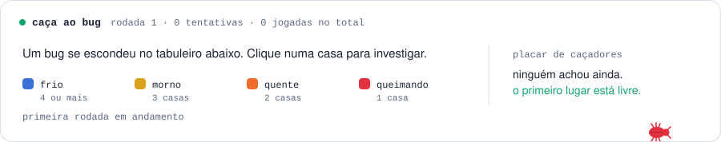

<div align="center">

<picture>
  <source media="(prefers-color-scheme: dark)" srcset="cartoes/cabecalho-escuro.svg">
  
</picture>

</div>

```java
public class GuilhermeViana {
    String formacao = "Análise e Desenvolvimento de Sistemas · Senac";
    String[] estudando = { "qualidade de software", "back-end com Spring Boot", "mobile com Expo" };
    String[] interesses = { "dados e processos", "IA aplicada", "SaaS para pequenos negócios" };
    String agora = "organizacao-recursos: API Java com CI, testes e SonarCloud";
}
```

<div align="center">

<picture>
  <source media="(prefers-color-scheme: dark)" srcset="cartoes/linguagens-escuro.svg">
  
</picture>
<picture>
  <source media="(prefers-color-scheme: dark)" srcset="cartoes/numeros-escuro.svg">
  
</picture>

<picture>
  <source media="(prefers-color-scheme: dark)" srcset="cartoes/atividade-escuro.svg">
  
</picture>

</div>

### 🐛 Caça ao Bug

Um bug se escondeu no tabuleiro. **Clique numa casa** para abrir uma jogada, depois em **Create**. Em alguns segundos um robô responde com a pista e o tabuleiro é atualizado aqui para todo mundo.

<div align="center">

<picture>
  <source media="(prefers-color-scheme: dark)" srcset="cartoes/jogo-escuro.svg">
  
</picture>

<!-- JOGO:INICIO -->
<table>
<tr><td></td><td align="center"><b>A</b></td><td align="center"><b>B</b></td><td align="center"><b>C</b></td><td align="center"><b>D</b></td><td align="center"><b>E</b></td></tr>
<tr><td align="center"><b>1</b></td><td><a href="https://github.com/guilhermevianacloud/guilhermevianacloud/issues/new?title=caca-bug%3A%20A1&body=Investigando%20a%20casa%20**A1**.%0A%0A%C3%89%20s%C3%B3%20clicar%20em%20**Create**%20%2F%20**Submit%20new%20issue**.%20Em%20alguns%20segundos%20o%20rob%C3%B4%20responde%20aqui%20com%20a%20pista%20e%20o%20tabuleiro%20do%20perfil%20%C3%A9%20atualizado."></a></td><td><a href="https://github.com/guilhermevianacloud/guilhermevianacloud/issues/new?title=caca-bug%3A%20B1&body=Investigando%20a%20casa%20**B1**.%0A%0A%C3%89%20s%C3%B3%20clicar%20em%20**Create**%20%2F%20**Submit%20new%20issue**.%20Em%20alguns%20segundos%20o%20rob%C3%B4%20responde%20aqui%20com%20a%20pista%20e%20o%20tabuleiro%20do%20perfil%20%C3%A9%20atualizado."></a></td><td><a href="https://github.com/guilhermevianacloud/guilhermevianacloud/issues/new?title=caca-bug%3A%20C1&body=Investigando%20a%20casa%20**C1**.%0A%0A%C3%89%20s%C3%B3%20clicar%20em%20**Create**%20%2F%20**Submit%20new%20issue**.%20Em%20alguns%20segundos%20o%20rob%C3%B4%20responde%20aqui%20com%20a%20pista%20e%20o%20tabuleiro%20do%20perfil%20%C3%A9%20atualizado."></a></td><td><a href="https://github.com/guilhermevianacloud/guilhermevianacloud/issues/new?title=caca-bug%3A%20D1&body=Investigando%20a%20casa%20**D1**.%0A%0A%C3%89%20s%C3%B3%20clicar%20em%20**Create**%20%2F%20**Submit%20new%20issue**.%20Em%20alguns%20segundos%20o%20rob%C3%B4%20responde%20aqui%20com%20a%20pista%20e%20o%20tabuleiro%20do%20perfil%20%C3%A9%20atualizado."></a></td><td><a href="https://github.com/guilhermevianacloud/guilhermevianacloud/issues/new?title=caca-bug%3A%20E1&body=Investigando%20a%20casa%20**E1**.%0A%0A%C3%89%20s%C3%B3%20clicar%20em%20**Create**%20%2F%20**Submit%20new%20issue**.%20Em%20alguns%20segundos%20o%20rob%C3%B4%20responde%20aqui%20com%20a%20pista%20e%20o%20tabuleiro%20do%20perfil%20%C3%A9%20atualizado."></a></td></tr>
<tr><td align="center"><b>2</b></td><td><a href="https://github.com/guilhermevianacloud/guilhermevianacloud/issues/new?title=caca-bug%3A%20A2&body=Investigando%20a%20casa%20**A2**.%0A%0A%C3%89%20s%C3%B3%20clicar%20em%20**Create**%20%2F%20**Submit%20new%20issue**.%20Em%20alguns%20segundos%20o%20rob%C3%B4%20responde%20aqui%20com%20a%20pista%20e%20o%20tabuleiro%20do%20perfil%20%C3%A9%20atualizado."></a></td><td><a href="https://github.com/guilhermevianacloud/guilhermevianacloud/issues/new?title=caca-bug%3A%20B2&body=Investigando%20a%20casa%20**B2**.%0A%0A%C3%89%20s%C3%B3%20clicar%20em%20**Create**%20%2F%20**Submit%20new%20issue**.%20Em%20alguns%20segundos%20o%20rob%C3%B4%20responde%20aqui%20com%20a%20pista%20e%20o%20tabuleiro%20do%20perfil%20%C3%A9%20atualizado."></a></td><td><a href="https://github.com/guilhermevianacloud/guilhermevianacloud/issues/new?title=caca-bug%3A%20C2&body=Investigando%20a%20casa%20**C2**.%0A%0A%C3%89%20s%C3%B3%20clicar%20em%20**Create**%20%2F%20**Submit%20new%20issue**.%20Em%20alguns%20segundos%20o%20rob%C3%B4%20responde%20aqui%20com%20a%20pista%20e%20o%20tabuleiro%20do%20perfil%20%C3%A9%20atualizado."></a></td><td><a href="https://github.com/guilhermevianacloud/guilhermevianacloud/issues/new?title=caca-bug%3A%20D2&body=Investigando%20a%20casa%20**D2**.%0A%0A%C3%89%20s%C3%B3%20clicar%20em%20**Create**%20%2F%20**Submit%20new%20issue**.%20Em%20alguns%20segundos%20o%20rob%C3%B4%20responde%20aqui%20com%20a%20pista%20e%20o%20tabuleiro%20do%20perfil%20%C3%A9%20atualizado."></a></td><td><a href="https://github.com/guilhermevianacloud/guilhermevianacloud/issues/new?title=caca-bug%3A%20E2&body=Investigando%20a%20casa%20**E2**.%0A%0A%C3%89%20s%C3%B3%20clicar%20em%20**Create**%20%2F%20**Submit%20new%20issue**.%20Em%20alguns%20segundos%20o%20rob%C3%B4%20responde%20aqui%20com%20a%20pista%20e%20o%20tabuleiro%20do%20perfil%20%C3%A9%20atualizado."></a></td></tr>
<tr><td align="center"><b>3</b></td><td><a href="https://github.com/guilhermevianacloud/guilhermevianacloud/issues/new?title=caca-bug%3A%20A3&body=Investigando%20a%20casa%20**A3**.%0A%0A%C3%89%20s%C3%B3%20clicar%20em%20**Create**%20%2F%20**Submit%20new%20issue**.%20Em%20alguns%20segundos%20o%20rob%C3%B4%20responde%20aqui%20com%20a%20pista%20e%20o%20tabuleiro%20do%20perfil%20%C3%A9%20atualizado."></a></td><td><a href="https://github.com/guilhermevianacloud/guilhermevianacloud/issues/new?title=caca-bug%3A%20B3&body=Investigando%20a%20casa%20**B3**.%0A%0A%C3%89%20s%C3%B3%20clicar%20em%20**Create**%20%2F%20**Submit%20new%20issue**.%20Em%20alguns%20segundos%20o%20rob%C3%B4%20responde%20aqui%20com%20a%20pista%20e%20o%20tabuleiro%20do%20perfil%20%C3%A9%20atualizado."></a></td><td><a href="https://github.com/guilhermevianacloud/guilhermevianacloud/issues/new?title=caca-bug%3A%20C3&body=Investigando%20a%20casa%20**C3**.%0A%0A%C3%89%20s%C3%B3%20clicar%20em%20**Create**%20%2F%20**Submit%20new%20issue**.%20Em%20alguns%20segundos%20o%20rob%C3%B4%20responde%20aqui%20com%20a%20pista%20e%20o%20tabuleiro%20do%20perfil%20%C3%A9%20atualizado."></a></td><td><a href="https://github.com/guilhermevianacloud/guilhermevianacloud/issues/new?title=caca-bug%3A%20D3&body=Investigando%20a%20casa%20**D3**.%0A%0A%C3%89%20s%C3%B3%20clicar%20em%20**Create**%20%2F%20**Submit%20new%20issue**.%20Em%20alguns%20segundos%20o%20rob%C3%B4%20responde%20aqui%20com%20a%20pista%20e%20o%20tabuleiro%20do%20perfil%20%C3%A9%20atualizado."></a></td><td><a href="https://github.com/guilhermevianacloud/guilhermevianacloud/issues/new?title=caca-bug%3A%20E3&body=Investigando%20a%20casa%20**E3**.%0A%0A%C3%89%20s%C3%B3%20clicar%20em%20**Create**%20%2F%20**Submit%20new%20issue**.%20Em%20alguns%20segundos%20o%20rob%C3%B4%20responde%20aqui%20com%20a%20pista%20e%20o%20tabuleiro%20do%20perfil%20%C3%A9%20atualizado."></a></td></tr>
<tr><td align="center"><b>4</b></td><td><a href="https://github.com/guilhermevianacloud/guilhermevianacloud/issues/new?title=caca-bug%3A%20A4&body=Investigando%20a%20casa%20**A4**.%0A%0A%C3%89%20s%C3%B3%20clicar%20em%20**Create**%20%2F%20**Submit%20new%20issue**.%20Em%20alguns%20segundos%20o%20rob%C3%B4%20responde%20aqui%20com%20a%20pista%20e%20o%20tabuleiro%20do%20perfil%20%C3%A9%20atualizado."></a></td><td><a href="https://github.com/guilhermevianacloud/guilhermevianacloud/issues/new?title=caca-bug%3A%20B4&body=Investigando%20a%20casa%20**B4**.%0A%0A%C3%89%20s%C3%B3%20clicar%20em%20**Create**%20%2F%20**Submit%20new%20issue**.%20Em%20alguns%20segundos%20o%20rob%C3%B4%20responde%20aqui%20com%20a%20pista%20e%20o%20tabuleiro%20do%20perfil%20%C3%A9%20atualizado."></a></td><td><a href="https://github.com/guilhermevianacloud/guilhermevianacloud/issues/new?title=caca-bug%3A%20C4&body=Investigando%20a%20casa%20**C4**.%0A%0A%C3%89%20s%C3%B3%20clicar%20em%20**Create**%20%2F%20**Submit%20new%20issue**.%20Em%20alguns%20segundos%20o%20rob%C3%B4%20responde%20aqui%20com%20a%20pista%20e%20o%20tabuleiro%20do%20perfil%20%C3%A9%20atualizado."></a></td><td><a href="https://github.com/guilhermevianacloud/guilhermevianacloud/issues/new?title=caca-bug%3A%20D4&body=Investigando%20a%20casa%20**D4**.%0A%0A%C3%89%20s%C3%B3%20clicar%20em%20**Create**%20%2F%20**Submit%20new%20issue**.%20Em%20alguns%20segundos%20o%20rob%C3%B4%20responde%20aqui%20com%20a%20pista%20e%20o%20tabuleiro%20do%20perfil%20%C3%A9%20atualizado."></a></td><td><a href="https://github.com/guilhermevianacloud/guilhermevianacloud/issues/new?title=caca-bug%3A%20E4&body=Investigando%20a%20casa%20**E4**.%0A%0A%C3%89%20s%C3%B3%20clicar%20em%20**Create**%20%2F%20**Submit%20new%20issue**.%20Em%20alguns%20segundos%20o%20rob%C3%B4%20responde%20aqui%20com%20a%20pista%20e%20o%20tabuleiro%20do%20perfil%20%C3%A9%20atualizado."></a></td></tr>
<tr><td align="center"><b>5</b></td><td><a href="https://github.com/guilhermevianacloud/guilhermevianacloud/issues/new?title=caca-bug%3A%20A5&body=Investigando%20a%20casa%20**A5**.%0A%0A%C3%89%20s%C3%B3%20clicar%20em%20**Create**%20%2F%20**Submit%20new%20issue**.%20Em%20alguns%20segundos%20o%20rob%C3%B4%20responde%20aqui%20com%20a%20pista%20e%20o%20tabuleiro%20do%20perfil%20%C3%A9%20atualizado."></a></td><td><a href="https://github.com/guilhermevianacloud/guilhermevianacloud/issues/new?title=caca-bug%3A%20B5&body=Investigando%20a%20casa%20**B5**.%0A%0A%C3%89%20s%C3%B3%20clicar%20em%20**Create**%20%2F%20**Submit%20new%20issue**.%20Em%20alguns%20segundos%20o%20rob%C3%B4%20responde%20aqui%20com%20a%20pista%20e%20o%20tabuleiro%20do%20perfil%20%C3%A9%20atualizado."></a></td><td><a href="https://github.com/guilhermevianacloud/guilhermevianacloud/issues/new?title=caca-bug%3A%20C5&body=Investigando%20a%20casa%20**C5**.%0A%0A%C3%89%20s%C3%B3%20clicar%20em%20**Create**%20%2F%20**Submit%20new%20issue**.%20Em%20alguns%20segundos%20o%20rob%C3%B4%20responde%20aqui%20com%20a%20pista%20e%20o%20tabuleiro%20do%20perfil%20%C3%A9%20atualizado."></a></td><td><a href="https://github.com/guilhermevianacloud/guilhermevianacloud/issues/new?title=caca-bug%3A%20D5&body=Investigando%20a%20casa%20**D5**.%0A%0A%C3%89%20s%C3%B3%20clicar%20em%20**Create**%20%2F%20**Submit%20new%20issue**.%20Em%20alguns%20segundos%20o%20rob%C3%B4%20responde%20aqui%20com%20a%20pista%20e%20o%20tabuleiro%20do%20perfil%20%C3%A9%20atualizado."></a></td><td><a href="https://github.com/guilhermevianacloud/guilhermevianacloud/issues/new?title=caca-bug%3A%20E5&body=Investigando%20a%20casa%20**E5**.%0A%0A%C3%89%20s%C3%B3%20clicar%20em%20**Create**%20%2F%20**Submit%20new%20issue**.%20Em%20alguns%20segundos%20o%20rob%C3%B4%20responde%20aqui%20com%20a%20pista%20e%20o%20tabuleiro%20do%20perfil%20%C3%A9%20atualizado."></a></td></tr>
</table>
<!-- JOGO:FIM -->

<sub>Quanto mais quente a casa, mais perto o bug está (distância na horizontal + vertical). Quem achar entra no placar e um novo bug se esconde.</sub>

</div>

### Em destaque

**[organizacao-recursos](https://github.com/guilhermevianacloud/organizacao-recursos)**: sistema de reserva de salas e recursos feito em Java 21 com Spring Boot. Tem pipeline de CI no GitHub Actions, testes de unidade, integração e BDD (Cucumber), cobertura com JaCoCo e análise no SonarCloud.

### Ferramentas

`Java` `Spring Boot` `Maven` `JavaScript` `React Native` `Expo` `Node.js` `SQL` `MySQL` `Docker` `Git` `GitHub Actions` `SonarCloud` `Linux`

### Vamos conversar

<a href="https://www.linkedin.com/in/guilherme-viana-lopes-a061922b1/">
  <picture>
    <source media="(prefers-color-scheme: dark)" srcset="cartoes/linkedin-escuro.svg">
    
  </picture>
</a>

<sub>Os cartões acima são gerados por [`scripts/gerar.mjs`](scripts/gerar.mjs) e atualizados todo dia pelo GitHub Actions. O jogo roda em [`scripts/jogo.mjs`](scripts/jogo.mjs). Nenhum serviço externo é usado.</sub>
