<div align="center">

<picture>
  <source media="(prefers-color-scheme: dark)" srcset="cartoes/cabecalho-escuro.svg">
  
</picture>

<picture>
  <source media="(prefers-color-scheme: dark)" srcset="cartoes/baleia-escuro.svg">
  
</picture>

</div>

```java
public class GuilhermeViana {
    String formacao = "Análise e Desenvolvimento de Sistemas · Senac";
    String[] infraestrutura = { "Microsoft 365", "Entra ID e AD", "Intune", "redes e Wi-Fi", "monitoramento" };
    String[] estudando = { "qualidade de software", "back-end com Spring Boot", "Docker e Linux" };
    String[] interesses = { "automação de rotinas de TI", "dados e processos", "IA aplicada" };
    String agora = "preventiva de notebooks pelo Intune + CI com SonarCloud";
}
```

<div align="center">

<picture>
  <source media="(prefers-color-scheme: dark)" srcset="cartoes/infra-escuro.svg">
  
</picture>

<picture>
  <source media="(prefers-color-scheme: dark)" srcset="cartoes/linguagens-escuro.svg">
  
</picture>
<picture>
  <source media="(prefers-color-scheme: dark)" srcset="cartoes/numeros-escuro.svg">
  
</picture>

<picture>
  <source media="(prefers-color-scheme: dark)" srcset="cartoes/atividade-escuro.svg">
  
</picture>

</div>

### Em destaque

**[organizacao-recursos](https://github.com/guilhermevianacloud/organizacao-recursos)**: sistema de reserva de salas e recursos feito em Java 21 com Spring Boot. Tem pipeline de CI no GitHub Actions, testes de unidade, integração e BDD (Cucumber), cobertura com JaCoCo e análise no SonarCloud.

### Ferramentas

**Infraestrutura:** `Microsoft 365` `Entra ID` `Active Directory` `Intune` `Teams` `SharePoint` `Redes e VLANs` `Wi-Fi` `Monitoramento` `Docker` `Linux`

**Desenvolvimento:** `Java` `Spring Boot` `Maven` `JavaScript` `React Native` `Expo` `Node.js` `SQL` `MySQL` `Git` `GitHub Actions` `SonarCloud`

### Vamos conversar

<a href="https://www.linkedin.com/in/guilherme-viana-lopes-a061922b1/">
  <picture>
    <source media="(prefers-color-scheme: dark)" srcset="cartoes/linkedin-escuro.svg">
    
  </picture>
</a>

<sub>Os cartões acima são gerados por [`scripts/gerar.mjs`](scripts/gerar.mjs) e atualizados todo dia pelo GitHub Actions. Nenhum serviço externo é usado.</sub>
